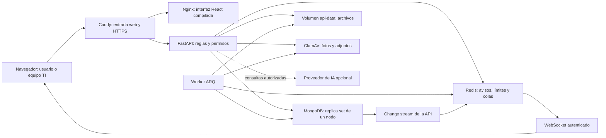
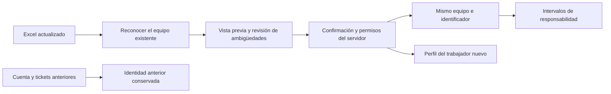
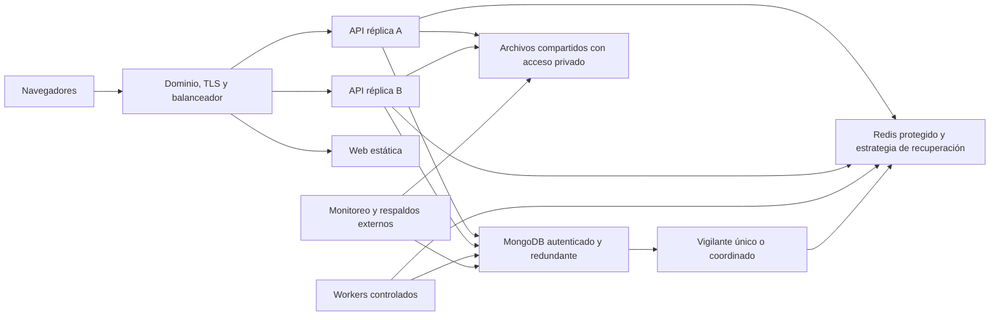

# Arquitectura y escalabilidad

Revisión del código: 06/11/2026; cierre documental 07/11/2026. La comparación de
infraestructura distingue la instalación de referencia y la propuesta para
operar y crecer. También se describe el antes/después funcional comprobable de
esta entrega. No se inventa una arquitectura histórica ni se presenta una
propuesta como si ya estuviera desplegada.

## Antes: arquitectura actual

El proyecto es un monolito modular: una API FastAPI con servicios por dominio,
una interfaz React/TypeScript y un worker ARQ. Docker Compose los organiza junto
con MongoDB, Redis, ClamAV y los servidores web. Separar carpetas de servicios no
convierte cada función en un microservicio.

| Capa | Responsabilidad actual | Datos que conserva |
| --- | --- | --- |
| React, router y cliente HTTP | Pantallas, formularios, filtros, accesibilidad y caché de consultas | Estado de interfaz; no es la base institucional |
| FastAPI, dependencias y servicios | Sesiones, permisos, validaciones y operaciones del dominio | Usa MongoDB/Redis y el volumen de archivos |
| MongoDB con PyMongo Async | Organización, personas, inventario, tickets, conversaciones e historiales | Datos persistentes e índices/migraciones |
| Redis | Límites, pub/sub y trabajos del worker | Estado temporal y persistencia Redis del Compose |
| Worker ARQ | SLA, sugerencias/modelos y tareas de limpieza/archivo | Trabaja sobre los mismos datos y archivos |
| Caddy/Nginx | Entrada, TLS cuando se configura dominio, estáticos y proxy | Certificados/configuración/logs en sus volúmenes |
| ClamAV | Examinar fotos y adjuntos antes de guardarlos | Firmas; no sustituye la seguridad de la aplicación |

El Compose habitual publica API y frontend directos solo en `127.0.0.1`; el proxy
es la entrada de la web. MongoDB y Redis no publican puertos y comparten la red
interna de datos. La instalación incluida no configura usuarios/contraseñas de
base de datos: el aislamiento de red es una defensa, no autenticación de la base
ni protección frente a alguien con control del anfitrión.

MongoDB usa un replica set de **un nodo** para las funciones que lo necesitan,
incluidos change streams y sesiones transaccionales. Un nodo no ofrece alta
disponibilidad. La aplicación tampoco garantiza que toda operación con múltiples
escrituras sea atómica: las sesiones deben pasarse a esas escrituras; por ejemplo,
la importación puede finalizar con filas correctas y filas rechazadas.

## Antes y después del cambio implementado

La referencia anterior es el código `fc5de05`; el cambio es `CAM-2026-001`. Los
servicios Docker y los tres roles operativos se conservan. El refuerzo ocurre
dentro de los servicios de negocio, los formularios y los controles de entrega.

| Área | Antes del cambio | Después del cambio |
| --- | --- | --- |
| Reconocer un equipo del Excel | La clave derivada del orden podía prevalecer sobre el patrimonio; reordenar filas podía asociarlas mal. | Identificación por patrimonio/MAC y coincidencias permitidas; los casos ambiguos se omiten para revisión. El ID existente se conserva. |
| Registrar al reemplazo | La creación opcional podía repetir el perfil en distintas filas de la misma persona. | Un perfil por persona/oficina dentro del lote; creación autorizada y sin credenciales. La cuenta anterior no se renombra. |
| Historial de componentes | Una alta dentro de un conjunto podía omitir su primer responsable individual. | Las nuevas altas registran también ese intervalo. El relevo por importación registra cada componente; no reconstruye periodos antiguos. |
| Aplicar un técnico sugerido por IA | Escritura específica que podía omitir reglas de asignación; el panel enviaba el nombre donde debía enviar el ID. | Identificador real y servicio normal de asignación, con autorización, disponibilidad, seguimiento y avisos. |
| Instalar y mantener | Descargas de parches con formato externo cambiante y documentación dispersa. | Parches verificados fijados, base Python por versión/digest, manuales por rol y comprobación de sincronía del Word. |

Esta automatización no vuelve atómico todo el lote, no identifica físicamente
un periférico sin datos suficientes y no crea un acceso de usuario a partir de
una contraseña inventada. Los límites se detallan en
[Relevo e importación](RELEVO_E_IMPORTACION.md) y en el
[registro de seguimiento](REGISTRO_DE_CAMBIOS.md).

## Organización funcional

| Dominio | Flujo que sostiene |
| --- | --- |
| Identidad y organización | Zona → oficina → persona; roles y administrador principal protegido |
| Inventario | Activos individuales, conjuntos de escritorio, responsables e historial |
| Importación e inventario anual | Actualización operativa por Excel y fotografías de campañas para comparar/verificar |
| Tickets y SLA | Reportar → identificar equipo/destino → asignar → atender → cerrar |
| Equipo TI | Perfiles, horarios, ausencias y disponibilidad |
| Conocimiento y reportes | Guías, consultas, PDF/Excel/CSV y auditoría operativa |
| IA | Reglas/modelos y consultas internas; chatbot externo opcional de lectura |

El código operativo está en `backend/app/services`; los contratos HTTP en
`backend/app/schemas` y las rutas en `backend/app/api/routes`. Los esquemas e
índices de MongoDB están en `backend/app/domain/schemas_db.py` y se evolucionan
con `backend/app/migrations`. Las claves se reciben por entorno, nunca por una
variable pública de la interfaz. Consulta también la
[guía de almacenamiento](ALMACENAMIENTO.md).

## Cómo llegan los cambios a otras cuentas

La API vigila cambios de las colecciones y publica avisos agrupados en Redis.
Los navegadores reciben dominios que deben actualizar por WebSocket; vuelven a
consultar la API, que verifica la sesión y los permisos. El canal común no entrega
documentos completos ni notas privadas a todas las cuentas. Las notificaciones
de personas/tickets tienen canales propios y el WebSocket comprueba la autorización
antes de enviar eventos.

Esta actualización necesita conectividad, MongoDB, Redis y una conexión válida.
No es una promesa de tiempo cero: hay agrupación de eventos, latencia y reconexiones.
Después de una desconexión se deben recuperar los datos vigentes.

## ¿Es escalable?

**Se puede ampliar, pero el Compose actual está preparado como instalación de un
solo servidor, no como un clúster de alta disponibilidad.** Los servicios de
dominio, índices, paginación, consultas agregadas, cliente asíncrono, worker y Redis
dan una base útil para crecer de forma gradual. La capacidad real depende del
servidor, tamaño de documentos, consultas, archivos y concurrencia.

El README conserva ensayos locales históricos de dos horas y pruebas con miles
de equipos ficticios; por ejemplo, 36.332 solicitudes con seis sesiones y cero
errores durante aquel ensayo. También registra aumentos de latencia con mayor
concurrencia. Son evidencias de esa laptop y versión, no una certificación de
cuántos trabajadores admite el servidor definitivo ni una medición nueva.

### Límites que hay que medir

- **Disco y disponibilidad:** base, archivos y volúmenes están en un anfitrión.
  Un fallo de disco, corte eléctrico o reinicio afecta a todo el servicio.
- **Consultas e informes:** agregaciones, Excel, PDF y cálculos estadísticos
  compiten por recursos. Los cálculos de scikit-learn incluyen trabajo síncrono;
  no basta con declarar una función `async` para que no consuma CPU de la API.
- **Memoria:** antivirus, base, API y worker comparten la RAM. Los Excel grandes
  y las instantáneas anuales requieren límites y medición con archivos reales.
- **Conexiones:** el pool MongoDB de la API está acotado a 50 conexiones por
  proceso; aumentar procesos multiplica conexiones y consumo.
- **Estado local:** cachés de modelos y ciertos estados residen en cada proceso.
  El volumen compartido de adjuntos existe dentro del anfitrión actual.
- **Proveedor IA:** sus cuotas/latencia no crecen automáticamente al ampliar la API.

No se recomienda ejecutar `--scale api` como solución inmediata: hay un puerto
directo fijo, migraciones al arrancar y un change stream por proceso. Varias
réplicas pueden duplicar invalidaciones y disputar inicializaciones. Deben
prepararse y probarse esos mecanismos primero.

## Después: propuesta por etapas

### Etapa 1: puesta en marcha controlada

Conservar la arquitectura actual en la PC-servidor dedicada o validada por TI.
Configurar dominio/HTTPS, reglas de red, acceso administrativo al anfitrión,
arranque tras reinicio, alimentación, espacio y observación de memoria/latencia.
Hacer una prueba piloto con el número y tipo de usuarios previstos.

Definir responsable operativo, conservación de datos, respuesta ante incidentes
y restauración de MongoDB **junto con** los archivos. Una copia en el mismo disco
no cubre el fallo del servidor. No se debe mezclar este plan con borrar datos
de una instalación existente.

### Etapa 2: separar trabajo costoso y almacenamiento

Medir primero las consultas lentas y ajustar índices/proyecciones. Trasladar a
trabajos en segundo plano los informes o cálculos que se confirme que bloquean
la atención. Definir estados de trabajo y resultados descargables; no solo añadir
procesos sin límites. Separar base/archivos o usar almacenamiento compartido cuando
el volumen lo requiera, manteniendo autorización para cada descarga.

### Etapa 3: alta disponibilidad si se necesita

Antes de esta etapa: ejecutar migraciones con coordinación, controlar cron/jobs
para que no se dupliquen, coordinar el vigilante de cambios, validar WebSocket
detrás del balanceador y compartir archivos/cachés que lo requieran. Cada réplica
debe validar los mismos permisos vigentes. Probar failover y restauración, no solo
la caída de un contenedor. Esta etapa exige cambios y operación adicionales; **no
está implementada por añadir el diagrama**.

## Criterio de aceptación del despliegue

| Verificación | Evidencia necesaria |
| --- | --- |
| Acceso | Dominio y certificado real válidos desde las redes previstas |
| Capacidad | Ensayo con concurrencia/archivos previstos y umbrales acordados de latencia y memoria |
| Continuidad | Recuperación tras reinicio y restauración demostrada en un destino separado |
| Seguridad | Revisión actual de dependencias/imágenes, permisos, archivos, exposición y secretos |
| Negocio | Piloto de alta/relevo, inventario, reporte y atención con todos los roles |
| Operación | Responsables, canales de incidencia, mantenimiento y registro de cambios definidos |

Mientras no se conozca el entorno definitivo, estas verificaciones quedan como
criterios de entrega y no como aprobaciones realizadas. La arquitectura final
debe quedar versionada junto con su configuración y resultados de prueba.
