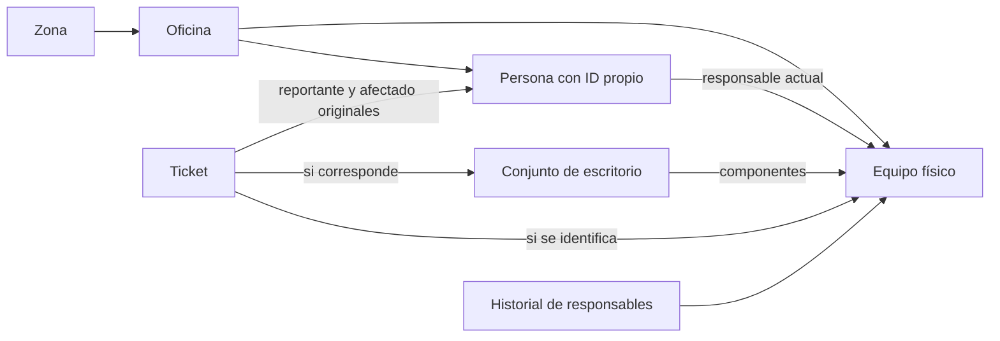

# Manual de base de datos y conservación de información

Guía técnica de la estructura implementada, revisada el 06/11/2026.
No contiene registros reales ni credenciales.

## Cómo se conectan las partes

MongoDB almacena documentos BSON; la API utiliza PyMongo asíncrono. La base
predeterminada es `mesa_ayuda`, seleccionada por `MONGO_DB`. `MONGO_URI` define el
servidor. Redis se configura por `REDIS_URL` y cumple funciones de caché, colas,
avisos y límites; no reemplaza la base de tickets.

El Compose incluido configura MongoDB como réplica de un nodo `rs0`: permite
transacciones pero no aporta alta disponibilidad. No publica el puerto 27017.
MongoDB y Redis no tienen autenticación configurada por defecto en ese Compose;
se aíslan en la red Docker. No deben exponerse directamente a Internet.

## Relación principal

Las relaciones se guardan como `ObjectId`, no como claves foráneas de SQL.
MongoDB no impone por sí solo la integridad entre colecciones: la preservan los
servicios y sus validaciones. Los nombres almacenados sirven como descripción;
el ID conserva la identidad.

## Diccionario por área

| Colecciones | Contenido y relación |
| --- | --- |
| `zonas`, `oficinas` | Organización territorial; una oficina referencia su zona. |
| `usuarios` | Identidad, rol, oficina, estado, preferencias, permisos e indicador de principal. Un perfil sin credenciales no puede iniciar sesión. |
| `sesiones` | Sesiones, vencimiento y revocación; no se guardan contraseñas en texto claro. |
| `tecnicos_perfil`, `ausencias`, `feriados` | Perfil de atención, horarios, ausencias y calendario laboral. |
| `activos`, `conjuntos` | Unidades físicas, responsable actual y agrupación exclusiva de PC de escritorio. |
| `historial_responsables`, `activos_cambios_componentes` | Intervalos de responsabilidad y cambios físicos asociados al patrimonio. |
| `tickets` | Código, asunto, origen, estado, prioridad, reportante, afectado, oficina, técnico y vínculos al inventario. |
| `ticket_eventos`, `ticket_mensajes`, `notas_internas` | Seguimiento, conversación permitida y notas privadas de TI. |
| `adjuntos` | Metadatos, propietario y ruta del archivo; el binario permanece en el volumen de subidas. |
| `articulos_kb`, `articulos_kb_valoraciones`, `respuestas_rapidas` | Guías, valoraciones y respuestas reutilizables. |
| `campanas_inventario`, `campana_items` | Campañas de comprobación y sus ítems. |
| `inventario_versiones` | Versiones anuales e instantáneas; no son una copia de seguridad integral del sistema. |
| `importaciones` | Lote, mapeo, filas, decisiones y resultados de la importación. |
| `ia_eventos`, `conversaciones_ia` | Sugerencias, decisiones y conversaciones de consultas internas. |
| `chatbot_conversaciones` | Historial privado del chatbot TI, añadido por la migración 026. |
| `auditoria` | Movimientos relevantes y alertas de administradores y técnicos según el filtro vigente. |
| `exportaciones`, `notificaciones`, `vistas_guardadas` | Informes generados, avisos y preferencias de consulta. |
| `catalogos`, `esquemas_tipos`, `valores_inventario` | Valores y esquemas del inventario. |
| `configuracion`, `contadores`, `_migraciones` | Ajustes, secuencias y versiones de la estructura. |

El catálogo de referencia está en `backend/app/domain/schemas_db.py`; las
migraciones posteriores pueden añadir colecciones e índices. No se debe deducir
que una colección no existe por no aparecer en la lista inicial.

## Identidad y relevo del trabajador

Ejemplo ficticio: Persona A e impresora con identificador E1. Al asignar esa
impresora a Persona B, cambia `activos.responsable_id` y se registra el intervalo
en `historial_responsables`. E1 sigue siendo E1. Los tickets de A conservan su
reportante y afectado; B recibe una identidad nueva.

La categoría, el nombre de la computadora y la posición de la fila no identifican
de forma suficiente un equipo. Los códigos patrimoniales pueden repetirse en el
modelo actual: su índice no es único desde la migración 009. Una coincidencia
ambigua exige revisión, no elegir el primer documento encontrado.

El proceso de Excel y sus límites se explican en
[Relevo e importación](../RELEVO_E_IMPORTACION.md).

## Índices y validadores

Entre los controles existentes están el código único de ticket, la clave natural
única del activo, el correo normalizado único cuando existe, la combinación de
zona/nombre de oficina y el índice parcial de administrador principal único.
Existen índices por reportante, afectado, oficina, activo, conjunto y fecha para
consultar antecedentes. Los validadores BSON aceptan los estados de ticket
actuales y los tres roles operativos.

No conviertas códigos patrimoniales en un índice único sin revisar previamente
los datos. No elimines índices para resolver una excepción sin analizar su causa.

## Retención implementada

| Información | Comportamiento actual |
| --- | --- |
| Cuenta desactivada | Tras 30 días completos, el worker la archiva. Conserva ID e historial; no borra automáticamente los tickets. |
| Sesiones vencidas | Índice TTL y limpieza del worker. El borrado TTL no es instantáneo. |
| Auditoría central | Ventana de 15 días con TTL y limpieza. No constituye un archivo legal permanente. |
| Exportaciones generadas | Limpieza programada a partir de 7 días; una descarga fuera del servidor no se elimina con ella. |
| Tickets, patrimonio y versiones anuales | No se aplica una eliminación automática general por antigüedad. Hay operaciones autorizadas de eliminación. |
| Chats | Persisten según su módulo y las acciones de eliminación; no se presupone una retención institucional aprobada. |

La conservación institucional y el tratamiento de datos personales requieren una
política aprobada. Cambiar un plazo necesita migración, ajuste del worker y de
las consultas que filtran por antigüedad; no basta con cambiar un índice TTL.

## Archivos, formatos y espacio

Las fotos y adjuntos se guardan en `/data/uploads`; Mongo conserva sus referencias.
Las exportaciones viven en `/data/exports`. Los volúmenes persisten aunque se
reemplace un contenedor. Consulta [Almacenamiento](../ALMACENAMIENTO.md) para
las rutas y el disco virtual de Docker Desktop.

Los documentos usan BSON, los intercambios de la API usan JSON y las fechas se
serializan en formato ISO. Los Excel se procesan a filas; no reemplazan el
almacenamiento de imágenes ni la identidad de los documentos.

## Operación segura

1. Comprueba disponibilidad con `docker compose exec api python -m app.scripts.salud`.
2. Consulta el estado de migraciones antes de actualizar. El inicio de la API
   aplica las pendientes; una migración fallida debe detener la entrega.
3. Revisa espacio de los volúmenes y permisos del host. No publiques volcados ni
   capturas de usuarios en incidencias del repositorio.
4. Prepara y ensaya recuperación con datos ficticios. La guía de traslado permite
   restaurar en un destino vacío y comprueba hashes de los archivos.
5. Para un respaldo autorizado de producción utiliza
   `python tools/trasladar.py respaldar backups/municipalidad.helpdesk.zip`.
   Ese proceso detiene temporalmente API y worker; programa la interrupción.
6. Conserva la configuración privada aparte. El paquete no incluye `.env` ni la
   clave necesaria para descifrar licencias. Protege también el propio paquete.

Un exporte de equipos no sustituye una copia de MongoDB más sus adjuntos. Nunca
uses una restauración, un `--drop` o `down -v` para corregir un formulario.
